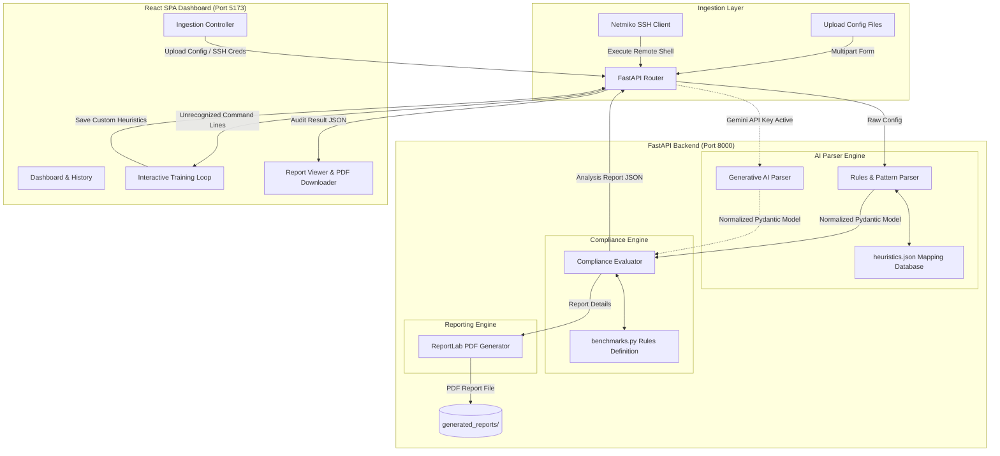

# Aegis Auditor - Technical Architecture Document
### AI-Driven Multi-Vendor Network Compliance Auditor (SIH 2026 - Problem Statement 155)

---

## 1. Architectural Overview

Aegis is built on a modular, decoupled architecture consisting of an asynchronous Python FastAPI backend API and a component-driven React + TypeScript frontend web portal. The system is designed to execute fast, offline-first compliance audits and adapt dynamically to new network syntaxes without backend code changes.

### System Architecture Diagram

---

## 2. Key Processing Pipelines

### A. Normalization Pipeline (The Translation Loop)
1. **Vendor Detection**: When a config is ingested, the engine runs heuristic keyword matches to determine the vendor platform (Cisco IOS, Juniper JunOS, Palo Alto PAN-OS, etc.).
2. **Text Normalization**: For hierarchical syntaxes (e.g. Juniper's curly-brace tree), the configuration text is preprocessed and flattened into single-line "set" statements to simplify parsing.
3. **Structured Mapping**: The configuration is parsed using precompiled regex models to extract values for standardized security fields defined in `base_parser.py` (e.g. `ssh_enabled`, `telnet_disabled`, `min_password_length`).
4. **Dynamic Override**: Before using standard regexes, the parser runs matches defined in the `heuristics.json` file. This lets user-defined regexes overwrite or add patterns dynamically.
5. **NLP Relevance Filter**: Unmatched lines containing security-related keywords (e.g. "ssh", "timeout", "secret") are classified and grouped inside `unrecognized_commands`.

### B. Compliance Evaluation & Remediation Pipeline
1. **Rule Comparison**: The standard compliance evaluator compares actual parsed parameters against expected benchmark values (CIS, NIST, DISA STIG, ISO 27001) using custom logic handlers (`eq`, `gte`, `lte`).
2. **Score Computation**: A compliance score ($0-100\%$) is calculated as a percentage of passing rules.
3. **Remediation CLI Compiler**: The engine extracts the vendor name and pairs failed rules with corresponding CLI commands from `benchmarks.py`. It compiles these sequences into a cohesive CLI configuration script (e.g., prefixing `configure terminal` for Cisco, or wrapping in `configure` / `commit` commands for Juniper).

---

## 3. Dynamic Learning Loop (Zero-Code Adaptation)

To solve the challenge of vendor syntactic diversity and firmware updates, Aegis features a low-code **Heuristics Training Loop**:

1. **Detection**: Unmatched security-relevant lines are displayed in the Interactive Heuristics GUI.
2. **NLP Classification**: The system uses keyword matching to automatically suggest the most likely parameter target (e.g., mapping `exec-timeout 15 0` to `exec_timeout_seconds`).
3. **User Action**: The network administrator clicks "Map", adjusts the match template (which is auto-escaped and parameterized into regexes like `exec-timeout (\d+) (\d+)`), defines the value, and clicks "Apply".
4. **Persistence**: The mapping is saved to `heuristics.json`.
5. **Real-Time Retraining**: The backend reloads the JSON, re-parses all stored configuration files, updates the compliance records, and updates the generated PDFs. Compliance scores update in real-time across the dashboard.

---

## 4. Technical Stack

- **Backend Framework**: Python FastAPI (High-performance, async support, auto-documenting Swagger).
- **Network Interface**: Netmiko (SSH connection engine supporting diverse hardware platforms).
- **PDF Generation**: ReportLab Platypus API (Dynamic, programmatically styled PDF generation).
- **AI Integrations**: Gemini 1.5 Flash (Structured schemas extraction and contextual CLI command generation).
- **Frontend SPA**: React 18, Vite (Fast build system), TypeScript (Type safety), Tailwind CSS, Lucide Icons.
- **Storage & Database Layer**:
  - **Primary**: MongoDB (via asynchronous `motor` and `pymongo` driver) for enterprise audit record retention, heuristics mapping storage, and cluster synchronization.
  - **Resilient Fallback**: Automatic local flat-file storage (`records.json` and `heuristics.json`), providing zero-downtime offline portability when disconnected.
  - **Database Collections**:
    - `audit_records`: Indexed compliance audit reports, device metadata, remediation outputs, and historical runs.
    - `heuristics`: Learned command-to-category regex mappings and vendor overrides.
    - `app_settings`: Persistent platform configurations and API credentials.
